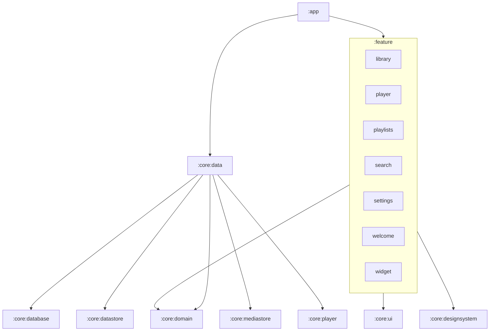

<div align="center">

# Navo

**A beautiful, fully offline music player for Android.**

Navo plays the music that already lives on your phone. No accounts, no streaming, no ads, no tracking, and not even the internet permission.

[](LICENSE)


**English** · [Русский](README.ru.md)

&nbsp;&nbsp;
&nbsp;&nbsp;


</div>

## Why Navo

Most music apps today want you online. Navo is for the music you already own: the files on your phone. It scans your device, organises everything into a clean library and plays it with a player that is pleasant to look at and fast to use.

- **Private by design.** The app has no `INTERNET` permission at all. Nothing is uploaded, nothing is downloaded, nothing is tracked.
- **Made with care.** A deep lapis and gold theme, a light parchment theme, a rotating medallion for every track, soft artwork glow and liquid glass details.
- **Open source.** Every line is here, under the Apache 2.0 license.

## Features

**Library**
- Tracks, playlists, albums, artists and folders, one swipe apart
- Sorting by title, artist, album, date added or duration
- Fast search across tracks, albums and artists
- Hide short tracks and whole folders you don't want to see

**Player**
- Now playing as a full-height bottom sheet with an artwork glow
- Shuffle, repeat all, repeat one, seek with a smooth progress bar
- Editable queue: reorder by dragging, remove, play next, add to queue
- Sleep timer with presets or "end of current track"
- Lock-screen, notification and headset controls through Media3
- Pauses automatically when headphones disconnect
- Home-screen widget with the current track and controls

**Collections**
- Favorites with one tap on the heart
- Playlists: create, rename, reorder, delete, with undo when removing tracks

**Sound and look**
- Built-in equalizer with presets, custom bands and bass boost
- Dark, light or system theme
- Cover art from your files, or a unique generated medallion when there is none

## Screenshots

<div align="center">

| Library | Albums | Search |
|:---:|:---:|:---:|
|  |  |  |

| Now playing | Queue | Sleep timer |
|:---:|:---:|:---:|
|  |  |  |

| Settings | Equalizer | Light theme |
|:---:|:---:|:---:|
|  |  |  |

</div>

## Getting started

Navo is not on any store yet, so build it from source.

**Requirements**
- Android Studio with JDK 17 or newer (the bundled JetBrains Runtime works)
- An Android device or emulator running Android 7.0 (API 24) or newer

```bash
git clone https://github.com/UMARJO9/NavoPlayerMusic.git
cd NavoPlayerMusic
./gradlew installDebug
```

On first launch Navo asks for access to your audio files (`READ_MEDIA_AUDIO` on Android 13+, `READ_EXTERNAL_STORAGE` on older versions). That is the only permission it needs.

## Tech stack

| Area | Libraries |
|---|---|
| Language | Kotlin 2.3, Coroutines and Flow |
| UI | Jetpack Compose, Material 3, Navigation Compose with type-safe routes |
| Playback | AndroidX Media3 (ExoPlayer and `MediaSessionService`) |
| Storage | Room for playlists, favorites and history, DataStore for settings |
| Music source | `MediaStore.Audio` |
| Dependency injection | Hilt with KSP |
| Widget | Jetpack Glance |
| Glass effects | [Kyant backdrop](https://github.com/Kyant0/AndroidLiquidGlass) |
| Tests | JUnit 4, kotlinx-coroutines-test, Turbine, hand-written fakes |
| Build | AGP 9, Gradle 9, version catalog, convention plugins in `build-logic` |

## Architecture

Navo is a multi-module app built on Clean Architecture with an MVI presentation layer.



- **Domain** (`:core:domain`) is pure Kotlin: models, repository interfaces and use cases. It knows nothing about Android, Room, Media3 or Compose.
- **Data** (`:core:data`) implements the repositories on top of Room, DataStore, MediaStore and Media3, and maps everything to domain models.
- **Features** depend only on the domain, the shared UI and the design system, never on each other. Screens talk through navigation routes wired in `:app`.
- **MVI** on every screen: an immutable `State`, a sealed `Intent`, one-shot `Effect`s, a `ViewModel` with a single `onIntent` entry point, a stateful `Route` and a stateless `Screen` with previews.

```
app/                 Application, MainActivity, navigation host
build-logic/         Gradle convention plugins
core/
  common/            dispatchers, result type, extensions
  domain/            models, repository interfaces, use cases
  data/              repository implementations and mappers
  database/          Room database, DAOs, entities
  datastore/         user settings
  mediastore/        scanning audio on the device
  player/            Media3 service and playback controller
  designsystem/      theme, components, medallions, glass
  ui/                MVI base classes and shared UI helpers
  testing/           fakes and test data
feature/
  library/  player/  playlists/  search/  settings/  welcome/  widget/
```

## Running tests

```bash
./gradlew testDebugUnitTest             # all unit tests
./gradlew :feature:player:testDebugUnitTest
./gradlew lint
```

ViewModels are tested with Turbine against hand-written fakes from `:core:testing`.

## Contributing

Issues and pull requests are welcome.

1. Fork the repository and create a branch from `main`.
2. Keep to the module rules above: features never depend on other features or on data modules.
3. Add or update tests for any ViewModel, use case or repository you touch.
4. Make sure `./gradlew assembleDebug testDebugUnitTest` passes.
5. Use short, imperative commit messages, for example `Add sleep timer to player`.

## License

```
Copyright 2026 Umarchon Nurmadov

Licensed under the Apache License, Version 2.0 (the "License");
you may not use this file except in compliance with the License.
You may obtain a copy of the License at

    http://www.apache.org/licenses/LICENSE-2.0

Unless required by applicable law or agreed to in writing, software
distributed under the License is distributed on an "AS IS" BASIS,
WITHOUT WARRANTIES OR CONDITIONS OF ANY KIND, either express or implied.
See the License for the specific language governing permissions and
limitations under the License.
```
