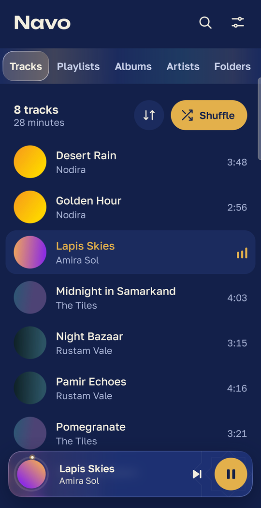
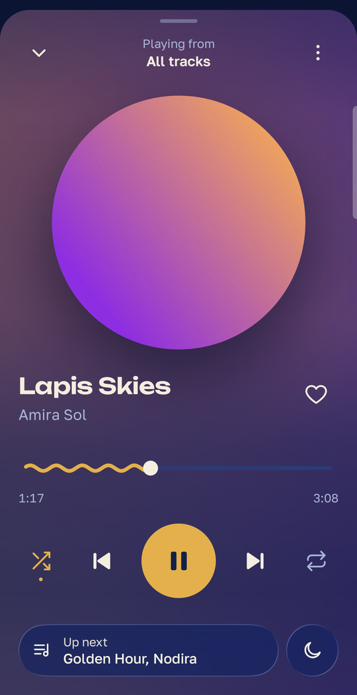
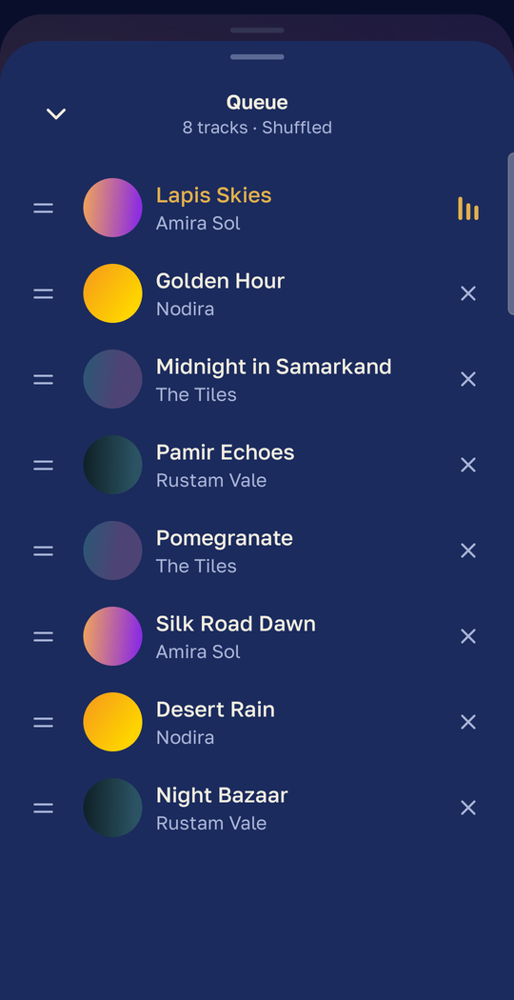
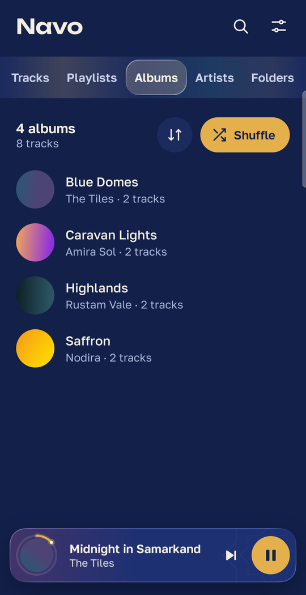
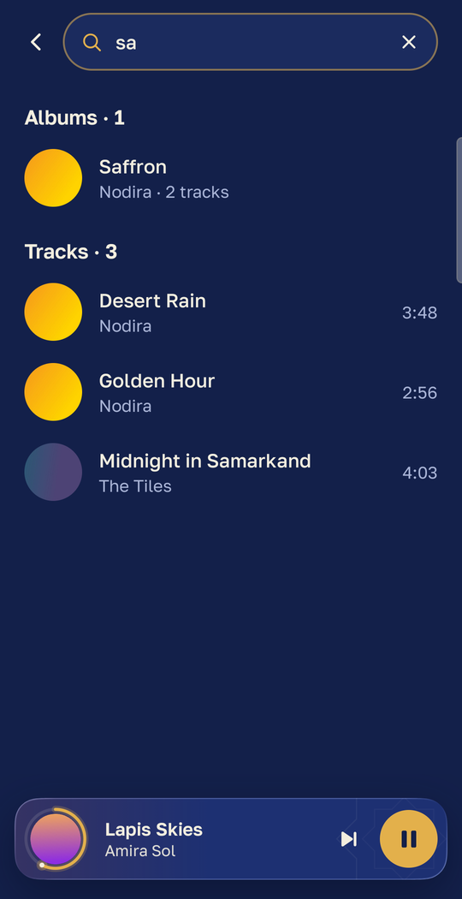
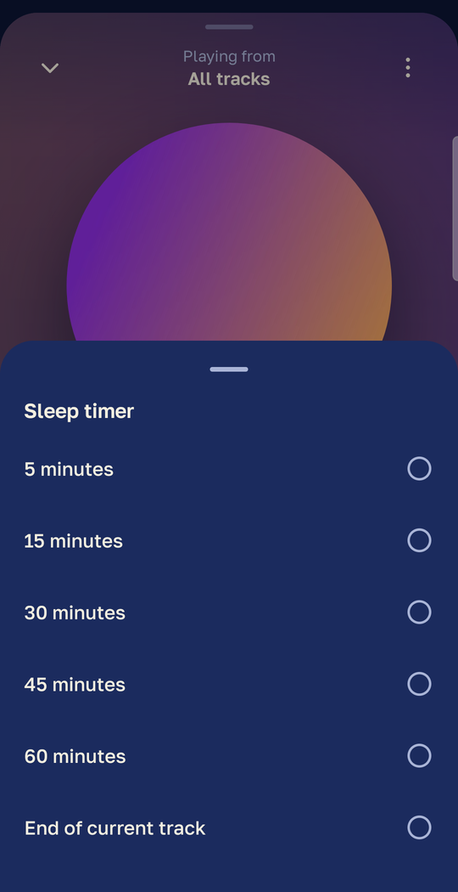
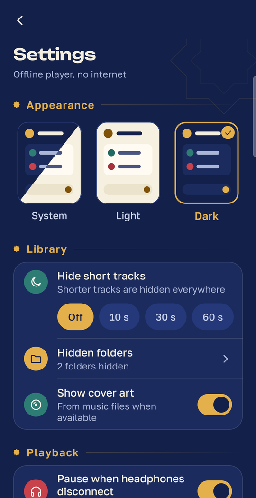
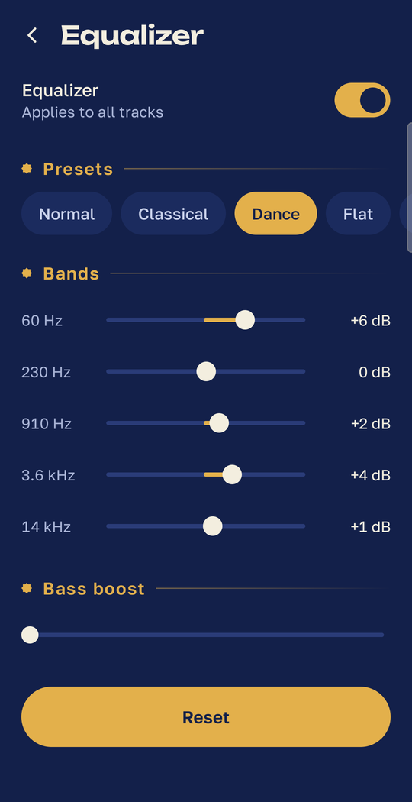
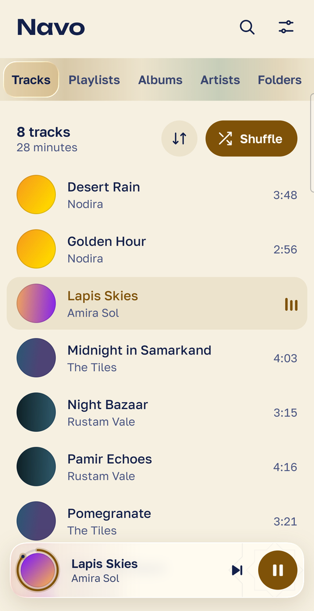
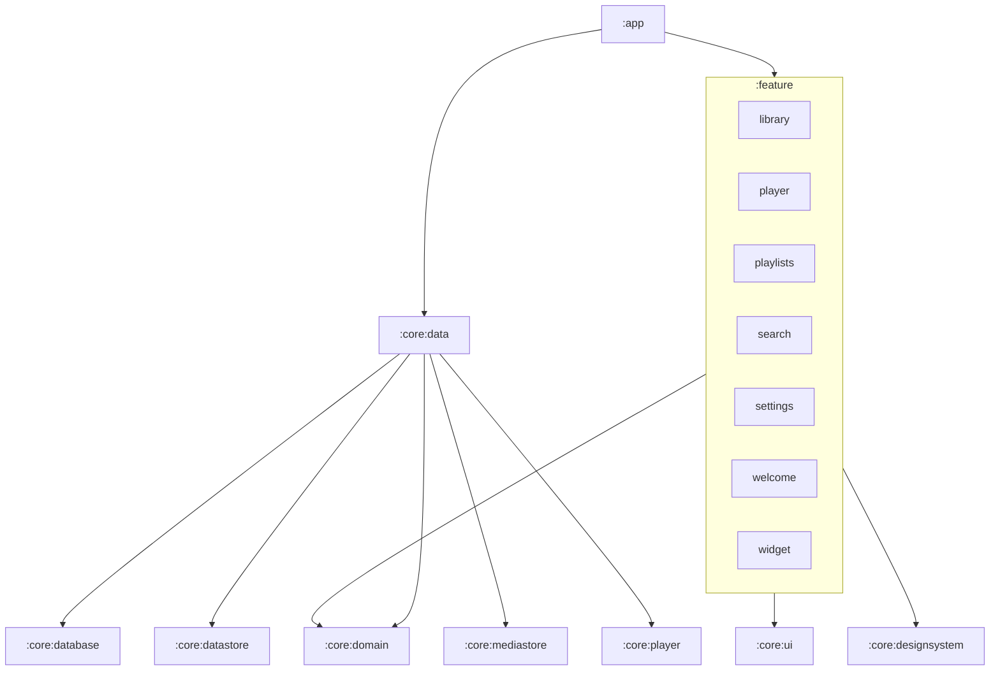

<div align="center">

# Navo

**Красивый музыкальный плеер для Android, который работает полностью офлайн.**

Navo играет музыку, которая уже есть на вашем телефоне. Без аккаунтов, без стриминга, без рекламы, без слежки и даже без разрешения на доступ в интернет.

[](LICENSE)


[English](README.md) · **Русский**

&nbsp;&nbsp;
&nbsp;&nbsp;


</div>

## Зачем Navo

Большинство музыкальных приложений сегодня требуют интернет. Navo создан для музыки, которая у вас уже есть, — файлов на телефоне. Он находит их, раскладывает по понятной библиотеке и играет в плеере, на который приятно смотреть и которым удобно пользоваться.

- **Приватность по умолчанию.** У приложения вообще нет разрешения `INTERNET`. Ничего не загружается, ничего не скачивается, ничего не отслеживается.
- **Сделано с любовью к деталям.** Глубокая тема цвета лазурита с золотом, светлая пергаментная тема, вращающийся медальон для каждого трека, мягкое свечение обложки и элементы из жидкого стекла.
- **Открытый код.** Весь исходный код здесь, под лицензией Apache 2.0.

## Возможности

**Библиотека**
- Треки, плейлисты, альбомы, исполнители и папки — в одном свайпе друг от друга
- Сортировка по названию, исполнителю, альбому, дате добавления или длительности
- Быстрый поиск по трекам, альбомам и исполнителям
- Скрытие коротких треков и целых папок, которые не хочется видеть

**Плеер**
- Экран «Сейчас играет» в виде полноэкранной шторки со свечением от обложки
- Перемешивание, повтор всех, повтор одного трека, плавная перемотка
- Редактируемая очередь: перетаскивание, удаление, «играть следующим», «добавить в очередь»
- Таймер сна с готовыми интервалами или до конца текущего трека
- Управление с экрана блокировки, из уведомления и с гарнитуры через Media3
- Автоматическая пауза при отключении наушников
- Виджет на рабочий стол с текущим треком и кнопками управления

**Коллекции**
- Избранное одним нажатием на сердечко
- Плейлисты: создание, переименование, сортировка, удаление, отмена удаления трека

**Звук и внешний вид**
- Встроенный эквалайзер с пресетами, ручной настройкой полос и усилением басов
- Тёмная, светлая или системная тема
- Обложки из файлов, а если обложки нет — уникальный сгенерированный медальон

## Скриншоты

<div align="center">

| Библиотека | Альбомы | Поиск |
|:---:|:---:|:---:|
|  |  |  |

| Сейчас играет | Очередь | Таймер сна |
|:---:|:---:|:---:|
|  |  |  |

| Настройки | Эквалайзер | Светлая тема |
|:---:|:---:|:---:|
|  |  |  |

</div>

## Как запустить

Navo пока нет в магазинах приложений, поэтому соберите его из исходников.

**Что нужно**
- Android Studio с JDK 17 или новее (встроенный JetBrains Runtime подходит)
- Устройство или эмулятор с Android 7.0 (API 24) или новее

```bash
git clone https://github.com/UMARJO9/NavoPlayerMusic.git
cd NavoPlayerMusic
./gradlew installDebug
```

При первом запуске Navo попросит доступ к аудиофайлам (`READ_MEDIA_AUDIO` на Android 13+, `READ_EXTERNAL_STORAGE` на более старых версиях). Это единственное разрешение, которое ему нужно.

## Технологии

| Область | Библиотеки |
|---|---|
| Язык | Kotlin 2.3, Coroutines и Flow |
| Интерфейс | Jetpack Compose, Material 3, Navigation Compose с типобезопасными маршрутами |
| Воспроизведение | AndroidX Media3 (ExoPlayer и `MediaSessionService`) |
| Хранение | Room для плейлистов, избранного и истории, DataStore для настроек |
| Источник музыки | `MediaStore.Audio` |
| Внедрение зависимостей | Hilt с KSP |
| Виджет | Jetpack Glance |
| Эффект стекла | [Kyant backdrop](https://github.com/Kyant0/AndroidLiquidGlass) |
| Тесты | JUnit 4, kotlinx-coroutines-test, Turbine, собственные фейки |
| Сборка | AGP 9, Gradle 9, version catalog, convention-плагины в `build-logic` |

## Архитектура

Navo — многомодульное приложение на Clean Architecture со слоем представления на MVI.



- **Domain** (`:core:domain`) — чистый Kotlin: модели, интерфейсы репозиториев и use case'ы. Он ничего не знает об Android, Room, Media3 или Compose.
- **Data** (`:core:data`) реализует репозитории поверх Room, DataStore, MediaStore и Media3 и превращает всё в доменные модели.
- **Фичи** зависят только от домена, общего UI и дизайн-системы и никогда друг от друга. Экраны связаны через навигационные маршруты, которые собираются в `:app`.
- **MVI** на каждом экране: неизменяемый `State`, sealed `Intent`, одноразовые `Effect`, `ViewModel` с единственной точкой входа `onIntent`, `Route` с состоянием и `Screen` без состояния с превью.

```
app/                 Application, MainActivity, навигация
build-logic/         convention-плагины Gradle
core/
  common/            диспетчеры, тип результата, расширения
  domain/            модели, интерфейсы репозиториев, use case'ы
  data/              реализации репозиториев и мапперы
  database/          база Room, DAO, сущности
  datastore/         настройки пользователя
  mediastore/        поиск аудио на устройстве
  player/            сервис Media3 и контроллер воспроизведения
  designsystem/      тема, компоненты, медальоны, стекло
  ui/                базовые классы MVI и общие UI-утилиты
  testing/           фейки и тестовые данные
feature/
  library/  player/  playlists/  search/  settings/  welcome/  widget/
```

## Тесты

```bash
./gradlew testDebugUnitTest             # все unit-тесты
./gradlew :feature:player:testDebugUnitTest
./gradlew lint
```

ViewModel'и тестируются с Turbine на собственных фейках из `:core:testing`.

## Как помочь проекту

Issues и pull request'ы приветствуются.

1. Сделайте форк и создайте ветку от `main`.
2. Соблюдайте правила модулей выше: фичи не зависят от других фич и от data-модулей.
3. Добавьте или обновите тесты для каждого ViewModel, use case или репозитория, который меняете.
4. Убедитесь, что `./gradlew assembleDebug testDebugUnitTest` проходит.
5. Пишите короткие сообщения коммитов на английском в повелительном наклонении, например `Add sleep timer to player`.

## Лицензия

Проект распространяется по лицензии [Apache License 2.0](LICENSE).

```
Copyright 2026 Umarchon Nurmadov

Licensed under the Apache License, Version 2.0 (the "License");
you may not use this file except in compliance with the License.
You may obtain a copy of the License at

    http://www.apache.org/licenses/LICENSE-2.0

Unless required by applicable law or agreed to in writing, software
distributed under the License is distributed on an "AS IS" BASIS,
WITHOUT WARRANTIES OR CONDITIONS OF ANY KIND, either express or implied.
See the License for the specific language governing permissions and
limitations under the License.
```
